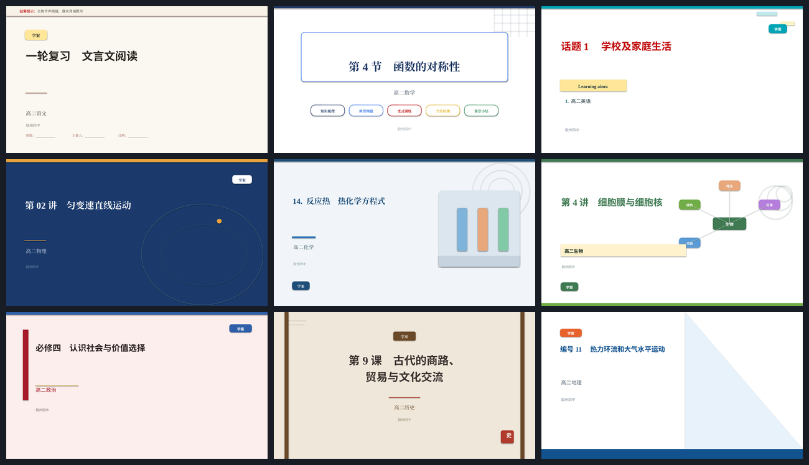
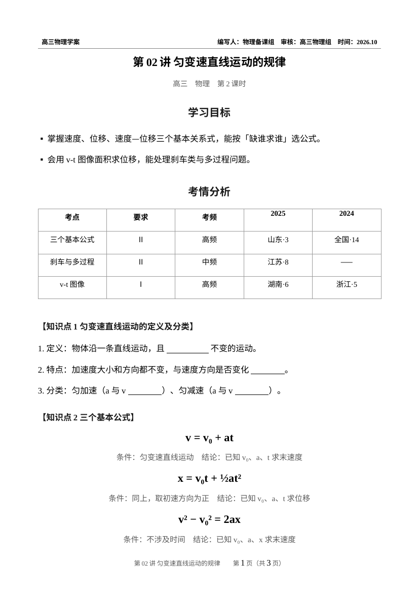
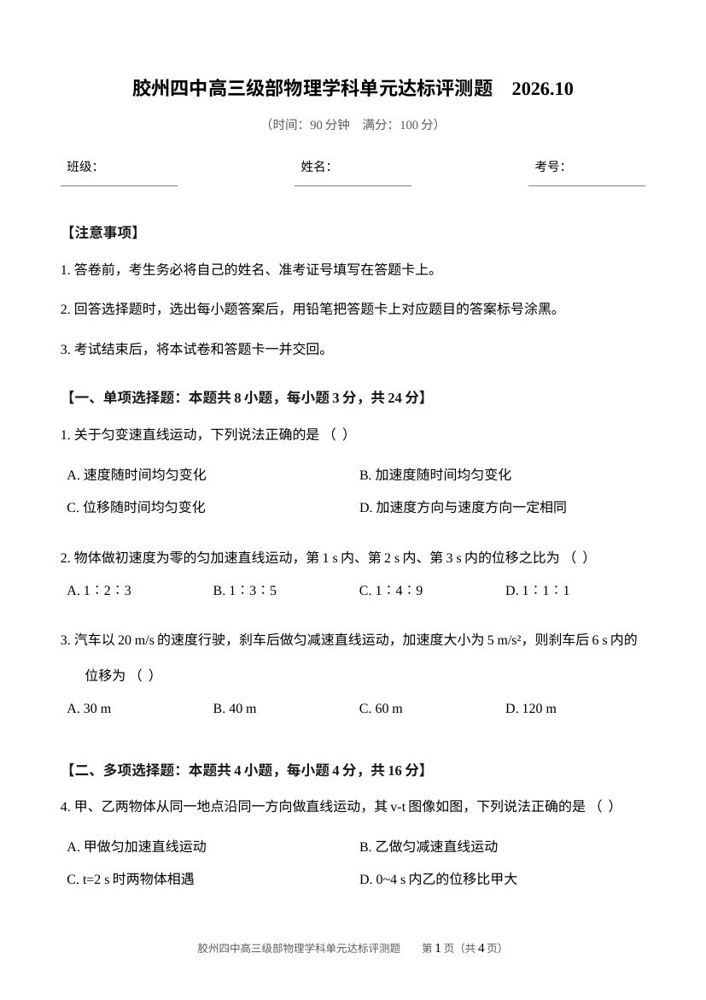
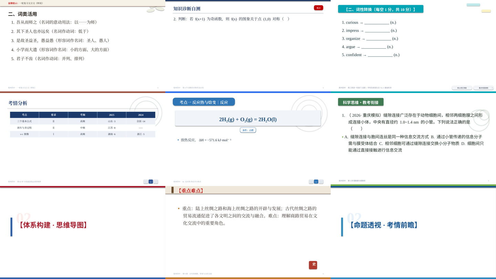
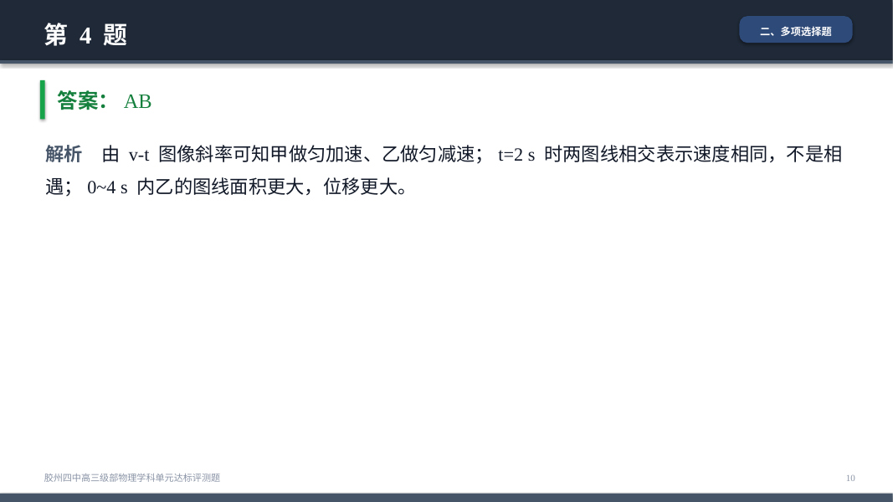
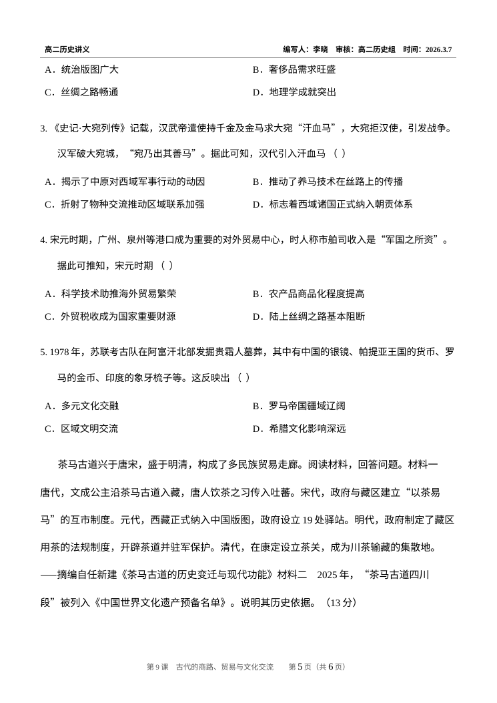
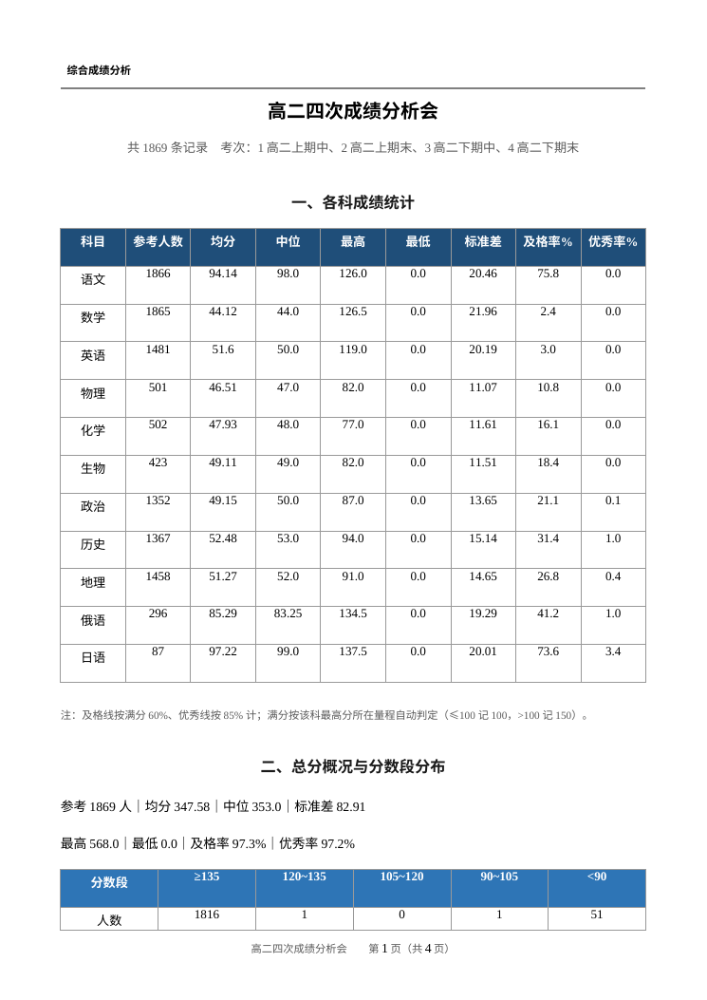
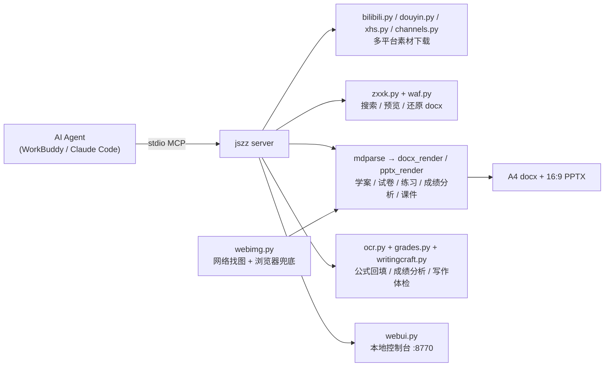

<p align="center">
  
</p>

<h3 align="center">jszz · 中学备课 MCP 工具集</h3>

<p align="center">
  给 <b>Agent</b> 用的备课工具箱：多平台找素材 → 学科网取题 → 学案/试卷/课件/练习/成绩分析一键出。<br>
  排版与写作规范不是拍脑袋：793 份真实教师资料全量抽取、479 份逐份深读逆向而来。
</p>

<p align="center">
  
  
  
  
  
  
  
</p>

<p align="center">
  装一次，任何支持 MCP 的客户端（<b>WorkBuddy</b> / Claude Code / Cline / Cherry Studio）都能调。
</p>

---

## 它解决什么问题

| 层 | 负责 | 换掉它意味着 |
|---|---|---|
| **素材获取** | B站/抖音/小红书/视频号下载；学科网搜资料、读预览、**还原可编辑 docx**、微信扫码登录；网络找图 | 手动翻网页、手抄题目 |
| **文档生成** | 学案/试卷/练习讲义/成绩分析 → 可打印 A4 docx；课件 → 16:9 PPT（九科各一套视觉） | 一晚上手动排版 |
| **版式与写作** | 从真实资料逆向的字体/字号/栏目词表/配色/答题语言（含评分边界、课堂口癖、图注句式、短句采分） | 「差不多就行」的 AI 排版 |

## 长什么样

| WebUI 控制台（B站/学科网扫码登录） | 九科课件封面（真实渲染） |
|---|---|
|  |  |

| 学案（A4，页眉/填空/红条提醒） | 试卷（A4，2×2 选项） |
|---|---|
|  |  |

| 九科专属页型 | 讲评课件（答案红色 + 解析） |
|---|---|
|  |  |

| 练习/讲义（每日一练·培优，题目+答案） | 成绩分析（11科统计+分数段） |
|---|---|
|  |  |

## ✨ 亮点

- 🎯 **规范从真实资料来**——793 个文件全量抽取（788 成功、405 万字），6 片并行深读 479 份 +
  130 份 Word 全读：栏目词表 150 词、题源标注粒度、评分负面边界、课堂运营口癖、图注句式，见
  [`docs/全库深读发现.md`](docs/全库深读发现.md)、[`docs/Word深读发现.md`](docs/Word深读发现.md)
- 📝 **写出来像真老师写的**——评分表有「不得分」边界、题源溯到教材页码
  （`来源：人教A版必修第二册P202例3`）、限时口令（`做题留痕，红笔改错`），不是 AI 教辅味
- ✍️ **写作工艺（语言层）**——`references/12-写作工艺.md` 全 788 份教师资料的语言规律：
  短句原则（阅卷按要点独立给分）、禁口语+规范表述红绿双栏、详解逐项排除、口诀、考情/素养四维；
  `jszz_style_check` 体检 + `jszz_scoring_suggest` 拆采分点，配套 `> 口诀/规范表述/采分/考情` 四种页型
- 📊 **成绩分析（grade）**——`make_grade_report` / `jszz grade`：成绩表（xlsx/JSON）→ 质量分析 docx，
  列检测适配真实三种成绩表（多考试长表/调考成绩单/单次考试，ID 列不误当分数），产出各科统计
  （均分/中位/标准差/及格率/优秀率）+ 分数段分布 + 名次榜（多考次去重）+ 单科榜首 + 班级对比
  + 进步/退步榜 + 等级分布
- 📝 **练习/讲义（drill）**——`make_drill` / `jszz drill`：覆盖语料里最高频却长期缺失的两类真实产出：
  「每日一练/限时小练」（纯题组+真题源内联）与「专题培优材料」（`培优知识点及达成目标→【典型例题】→
  【解题思路】→【变式训练】→学生反思总结`五栏目链），可选答案版
- 📄 **学案带答案版**——`make_xuean(answers=True)`：答案红色压下划线填回，与老师手写答案版同款
- 🖼️ **九科各一套 PPT 视觉**——封面/页头/装饰/专属页型都不同，按 `> 学科：` 自动选型
  （忘写学科也会从标题猜，不再出现物理卷戴语文口令）
- 📥 **统一取材入口**——`material_fetch(url)` 贴任意链接自动识别平台（B站/抖音/小红书/视频号）
  分发下载，不用记各平台工具名；小红书 `xhs_*`（cookie 门控，登录态递归抠 `masterUrl/imageList`，
  curl_cffi impersonate 过反爬；无 cookie 如实报 need_login 不假装）
- 🎬 **抖音/视频号取素材**——抖音 `douyin_info/douyin_download`（分享页 `_ROUTER_DATA` 抠
  `play_addr` 无水印直链，借鉴 GitHub 开源 Evil0ctal；cookie 过 JS 质询自动收割）；微信视频号
  `channels_*`（给定桌面助手抓的直链+key → 服务端下载解密；「链接→视频」需微信客户端登录态，
  服务端做不到，如实标注边界不假装）
- 🖼️ **网络找图 + 真实图注句式**——`tools/webimg.py` 搜图下载（必应/Wikimedia），
  图注照真实资料写（`图N示意…（单位：m）`、一文多图用「图N所示」精确指代），
  见 [`skill/references/11-图片引用.md`](skill/references/11-图片引用.md)
- 📊 **阅卷分析五段式**——试题分析→评分标准→答题优点→突出问题→备考提示，试卷讲评直接出
- 🔍 **公式 OCR 回填**——学科网预览的公式是位图，OCR 插回原行位置，讲评不再满屏空括号
- 🚀 **一键讲评**——`zxxk_review_deck(document_id)`：学科网资料 → 打印卷 + 讲评 PPT 一步到位
- 🧾 **产出体检**——越界/溢出/占位符残留/空白页自动查，`jszz check` 一条命令

## 架构



```
server/jszz/    36 个 MCP 工具 + 渲染器 + WebUI（8942 行）
skill/          SKILL.md + 12 篇排版规范（打包成 dist/jszz.skill）
examples/       11 份学科样例（九科 + 2 份变体）+ 学案/试卷示例 Markdown
tools/          webimg 找图（浏览器兜底）· asset_lib 素材索引 · shots_covers · readme_numbers
tests/          3 套测试（离线渲染+回归 / MCP 端到端 / 学科网预览）
docs/           语料分析 · 全库深读发现 · Word深读发现 · 六科内容地图 · 截图
```

## 安装

```bash
git clone https://github.com/wohongshi/jszz.git
cd jszz
pip install -e .                         # jszz 命令 + mcp/python-docx/python-pptx/rapidocr
sudo apt install nodejs                  # 过学科网 WAF 必需
pip install yt-dlp && sudo apt install ffmpeg   # 可选：下载 B 站音视频
```

> 不想装成包也行：`pip install -r requirements.txt`，把命令里的 `jszz` 换成
> `python -m jszz.cli`，`PYTHONPATH` 指向 `server/`。

也可以直接装技能包 [`dist/jszz.skill`](dist/jszz.skill)（SKILL.md + 12 篇规范），
让 Agent 按真实资料的写作规律出稿。

## 接入 MCP

**stdio（推荐，WorkBuddy / Claude Code / Cline 都支持）**

```json
{
  "mcpServers": {
    "jszz": {
      "command": "python3",
      "args": ["-m", "jszz.server"],
      "env": {
        "PYTHONPATH": "/绝对路径/jszz/server",
        "JSZZ_HOME": "/绝对路径/.jszz"
      }
    }
  }
}
```

**HTTP**（远程/多人共用）：

```bash
jszz serve --http --port 8765     # streamable-http 端点 http://127.0.0.1:8765/mcp
```

## 打开控制台（登录 / 依赖 / 产物）

```bash
jszz web            # http://127.0.0.1:8770/
```

- **B站扫码登录**：点「获取二维码」→ B 站 App 扫一扫 → 自动写入 cookie（也可手动粘贴）
- **学科网扫码登录**：点「获取二维码」→ 微信扫码 → 手机上点「同意学科网登录」→ 自动落 cookie
  （逆向 sso.zxxk.com 的扫码流程：WebSocket 状态通道 + dologin；也可手动粘贴）
- 学科网 cookie：解锁原文件下载与组卷网搜题；不填也能搜索、能读预览页
- 依赖自检：`yt-dlp` / `ffmpeg` / `node`；一键复制 MCP 配置

## 三分钟跑通

```bash
# 1. 命令行试一下（不用 MCP 客户端）
jszz set school 胶州四中
jszz search "匀变速直线运动" --limit 5
jszz xuean examples/xuean-wuli.md --answers   # → docx + 答案版 + pptx（学科自动选型）
jszz paper examples/paper-wuli.md             # → docx + 讲评 pptx
jszz drill examples/xuean-wuli.md --answers   # → 练习/讲义 docx（每日一练/培优）
jszz grade 成绩表.xlsx --notes "关注低分段"    # → 成绩分析报告 docx

# 2. 网络找图（HTTP 被挡自动切浏览器兜底）
python3 tools/webimg.py search "热力环流示意图" --count 6
python3 tools/webimg.py download "<图URL>" --title "…" --query "…"

# 3. 在 Agent 里
#    "用 jszz 出一份《匀变速直线运动》第1课时的学案和课件，配两张示意图"
#    "从学科网找 3 道动量守恒的题，组一份 100 分的小卷"
#    "把这个学科网卷子直接出成讲评 PPT"
#    "把这份成绩表出成质量分析报告"
```

## 能力一览

| # | 能力 | 工具 |
|---|---|---|
| 1 | B站搜索 / 详情 / 字幕 / 音视频下载 | `bili_search` `bili_video_info` `bili_subtitle` `bili_download` `bili_audio_stream` |
| 2 | 学科网搜索 / 版本清单 / 预览正文 / **还原 docx** / 抠图 / 组卷网搜题 | `zxxk_search` `zxxk_document` `zxxk_preview_files` `zxxk_preview_text` `zxxk_preview_docx` `zxxk_preview_images` `zxxk_questions` `zxxk_knowledge_questions` |
| 3 | **一键讲评**（学科网资料 → docx + 讲评 PPT） | `zxxk_review_deck` |
| 4 | **OCR**：预览页公式回填 / 任意图片转文字（水印剔除、落盘缓存） | `zxxk_preview_ocr` `jszz_ocr` |
| 5 | 学案编写（docx，可出答案版） | `make_xuean` |
| 6 | 学案自动生成 PPT（九科视觉，学科自动选型） | `make_xuean(pptx=True)` |
| 7 | 试卷编写 / 组卷（docx，带答案页） | `make_paper_md` `assemble_paper` |
| 8 | 试卷转讲评 PPT（跟随学科风格） | `make_paper_md(pptx=True)` |
| 9 | **练习/讲义**（每日一练/限时小练/专题培优，可出答案版） | `make_drill` |
| 10 | **成绩分析**（成绩表→质量分析报告，指标齐全） | `make_grade_report` |
| 11 | **抖音**：解析 / 下载 mp4+mp3 / 音频直链 | `douyin_info` `douyin_download` `douyin_audio_stream` |
| 12 | **小红书**：解析 / 下载（cookie 门控） | `xhs_info` `xhs_download` `xhs_status` |
| 13 | **微信视频号**：直链+key 下载解密（诚实标注边界） | `channels_status` `channels_probe` `channels_download` |
| 14 | **统一取材**：贴任意链接自动识别平台分发 | `material_fetch` |
| 15 | **写作工艺**：详解逐项排除 / 短句采分 / 禁口语 / 口诀 / 题源体检 | `jszz_style_check` `jszz_scoring_suggest` |
| 16 | 网络找图（必应/Wikimedia，浏览器兜底，来源入库） | `tools/webimg.py` |
| 17 | 产出体检 / 状态 / 配置 | `lint_markdown` `jszz_status` `jszz_configure` |

## 排版规范怎么来的

不是「AI 觉得好看」，是对一线教师的真实资料逐份测量：

| 取证 | 规模 | 产出规范 |
|---|---|---|
| 全量语料统计 | 837 个文件、892 万字符 | 字号/栏目/结构骨架 → [`docs/corpus-analysis.md`](docs/corpus-analysis.md) |
| **793 份全量抽取 + 479 份逐份深读** | 405 万字，6 片并行 | 写作规律/评分边界/口癖 → [`docs/全库深读发现.md`](docs/全库深读发现.md) |
| **130 份 Word 全量深读** | 历史 34 份 106 条 + 政史地 PPT 补证 | 九科写作规范 → [`docs/Word深读发现.md`](docs/Word深读发现.md) |
| 语言层量化 + 跨科平衡采样 | 全 788 份（警示易错 3342 句/口诀 1845 句…） | 短句采分/禁口语/详解体例 → `references/12` |
| 课件逐页目视 + vision 读图 + PIL 色值复核 | 25+ 份真实课件（含政史地内页） | 九科 PPT 视觉语言 → `references/09` |
| 学案/试卷 run 级样式 | 11 份 docx（含真实答案版对比） | 答案版/页眉/选项排布 → `references/10` |
| 图注引用统计 | 405 万字全库 | 图注句式/指代词/组题锚点 → `references/11` |
| 成绩表结构取证 | 11 份真实成绩表（3 种形态） | 成绩分析列检测/指标 → `grades.py` |

<details><summary>九科样例与专属页型（点击展开）</summary>

| 学科 | 封面 | 专属页型 | 触发指令 |
|---|---|---|---|
| 语文 | 提示横条 + 黄底篇目标签 | 引文页 | `> 引文：…——出处` |
| 数学 | 细线框标题牌 + 彩色标签组 | 公式页 | `> 公式：… \| 条件：… \| 结论：…` |
| 英语 | Learning aims + 青色【栏目】块 | 英汉对照页 | `> 对照：EN \| 中文` |
| 物理 | 深蓝轨道弧线 + 页码方块 | 公式页 | 同数学 |
| 化学 | 试管卡片 + 蓝胶囊页头 | 反应式页 | `> 反应：… \| 条件：…` |
| 生物 | 绿块栏目 + 放射概念图 | 概念图页 | `> 概念：中心词 > 分支：…` |
| 政治 | 红竖条 + 政务蓝 + 金线 | 时政材料页 | `> 材料：… \| 设问：…` |
| 历史 | 宣纸卷轴 + 朱红印章 | 史料页 | `> 史料：…——摘编自…` |
| 历史/政治 | （同上） | 答题模板页 | `> 模板：答题模式：… \| 标签：××` |
| 地理 | 斜切云天 + 深蓝底带 | 图表页 | `> 图表：… \| 判读：…` |
| 通用 | — | 口诀/规范表述/采分/考情 | `> 口诀：…` / `> 规范表述：错｜对` / `> 采分：…` / `> 考情：…` |

</details>

<details><summary>真实资料 vs AI 教辅的五个硬差异（写作规范的核心，点击展开）</summary>

深读 479 份资料总结的「像真老师写的」判据，全部写进 `skill/references/01`：

1. **题源溯到页码**：`（2025·山东高考·10）`、`来源：人教A版必修第二册P202例3`，不写笼统「高考真题」
2. **评分表有负面边界**：`（答"宣言推动解放"不得分）`、`若只抄原文不翻译，此点0分`
3. **课堂运营痕迹**：`限时12分钟`、`做题留痕，红笔改错`、`会的 Pass，只背不会的`
4. **允许毛边与即兴**：同题两稿答案、教师旁批「有更简洁漂亮的解法！」
5. **方法指导收尾动员语**：`错题本记录的不是"这道题怎么做"，而是"我当时为什么想错"`

</details>

<details><summary>设计要点（点击展开）</summary>

**学科网预览 JSON = 版本清单。** 未文档化接口 `FirstLoadPreviewJson` 一次给出
「原卷版 / 解析版」各自的预览页数与全本页数，据此判断值不值得下载。

**预览页可以还原成可编辑 docx。** 预览页是 SVG：文字带坐标、公式是内嵌位图。
`zxxk_preview_docx` 按坐标把文字重排成行、位图插回原位（实测一份数学卷：
1065 字 + 45 张内嵌图）。坑有三个：`x` 是逐字形坐标列表、`font-size` 挂在父级
`<g>`、还有一层 y=0 隐藏文本层要剔除。

**WAF 用页面自己的 JS 解。** 学科网/组卷网在阿里云 WAF 后面，本工具用 Node `vm`
跑页面脚本算 cookie，不引浏览器、不装 Playwright。

**网络找图带完整浏览器兜底。** HTTP 抓图被反爬时自动切 chromedriver 真浏览器：
搜索走 DOM 解析，下载走页面上下文 fetch（自带 Referer/Cookie，防盗链可破）。
坑：目标站把 http 重定向到 https 后，页面内再 fetch `http://…` 会被 Chrome 按
混合内容拦掉——必须用同源相对路径取图。

**抖音走分享页 play_addr。** `_ROUTER_DATA` 递归抠无水印直链（playwm→play），
yt-dlp 的 Douyin extractor 顽固报 "Fresh cookies needed" 作兜底；cookie 需真浏览器
过 JS 质询收割（`MozillaCookieJar.save()` 写文件，手搓 Netscape 会栽断言）。

**成绩表列检测要剔 ID 列。** 学籍号/考号是长整数，被当分数求均分会出 2.02e18 的荒谬值；
多考次长表名次榜按「每人最近一次」去重，否则同一学生占 N 个名次。

**栏目标题先归一再匹配。** 真实资料的栏目写法五花八门（`【学习目标】`/`一、试题分析`），
`mdparse.sec_key()` 统一剥掉括号序号再对 150 词词表，别让格式把栏目拦在门外。

**学科自动选型。** md 写 `> 学科：物理` 最准；忘写了会从标题猜（`ss.guess()`），
显式 `--theme` 才覆盖——不再出现物理卷戴语文早读口令。

**三色分工从真实课件拆出。** 红=答案/纠错/易错（九科通吃），蓝=标题/要点/解析，
黄=高亮标签。满屏红等于没有红。

**OCR 三防。** P 模式透明底先转 RGBA 合白底（直接转 RGB 透明区变黑、OCR 全瞎）；
水印只剔片段不整段丢（公式+水印混排曾整图陪葬）；超大图先降到 1600px（ONNX 发热大户）。

**产出体检。** `lint_markdown` 查写作层（挖空配对、大题分值、选项写法），
`jszz_style_check` 查语言层（详解逐项排除、短句采分、禁口语），`jszz check` 查文件层
（形状越界、文本框溢出、占位符残留、空白页、表格超宽）。

</details>

## 测试

```bash
./tests/selftest.py          # 离线渲染自检（docx/pptx 断言 + 栏目/图片/OCR/成绩/写作工艺回归）
./tests/test_mcp.py          # MCP stdio 端到端（36 工具注册 + 生成链路）
./tests/test_zxxk_preview.py # 学科网预览接口（需网络）
```

## 已知限制

<details><summary>如实声明（点击展开）</summary>

- 学科网预览的**公式是位图**：还原 docx 里是图不是 OMML 公式；OCR 回填是
  「尽力而为」，符号不保证全对，印刷前人工核对
- 学科网**免费预览只有 3–5 页**，全本要下载原件（需要账号点数，本工具不绕过付费）
- 组卷网（zujuan）反爬强，机房 IP 常被直接阻断；学校/家庭宽带一般可用
- **小红书**笔记媒体靠登录态+签名 API，未登录拿不到直链（`xhs_status` 如实报边界）；
  有 cookie 可下载
- **微信视频号**「链接→视频」需微信客户端登录态，服务端做不到；只支持给定桌面助手
  抓的直链+key 下载解密
- **网络找图版权**：必应搜出的图多为教辅站转载，内部教学使用标注「来源：网络」；
  公开出版物请用 Wikimedia（CC 授权、自带作者信息）或自行取得授权
- 下载 B 站/抖音视频依赖 `yt-dlp`，其接口随平台改动，升级 `yt-dlp` 即可
- 语文/数学/英语的学案写作样本以课件与试卷为主，学案 docx 样本偏历史/化学/生物

</details>

## 文档索引

| 文档 | 内容 |
|---|---|
| [`docs/corpus-analysis.md`](docs/corpus-analysis.md) | 837 份语料的统计报告（数字出处） |
| [`docs/全库深读发现.md`](docs/全库深读发现.md) | 479 份深读的写作规律与栏目词表（405 万字） |
| [`docs/Word深读发现.md`](docs/Word深读发现.md) | 130 份 Word 全量深读（历史 34 份写作规律 + 政地缺口声明） |
| [`docs/六科内容地图.md`](docs/六科内容地图.md) | 六科内容骨架与教法 |
| [`skill/SKILL.md`](skill/SKILL.md) | 给 AI Agent 的完整使用说明 |
| `skill/references/01–12` | 学案/试卷/课件/Markdown/学科网/B站/模板/视觉/取证/图片引用/写作工艺规范 |

## License

MIT
