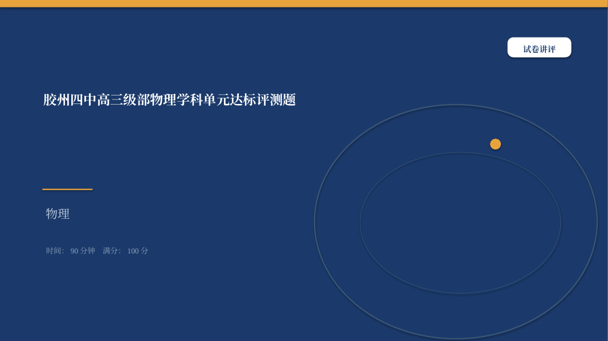
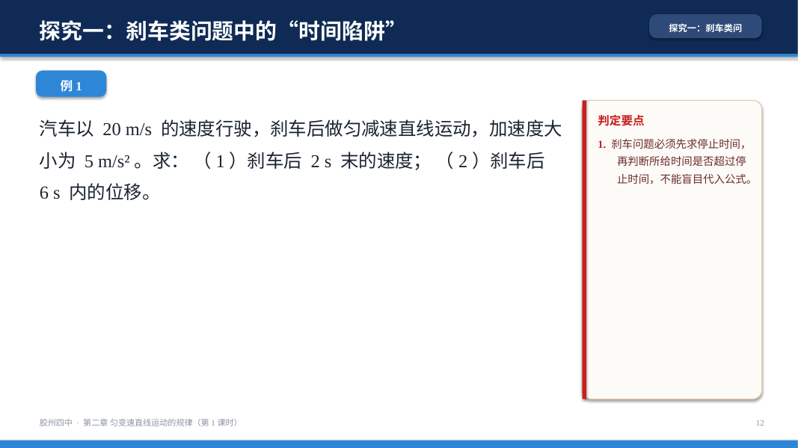
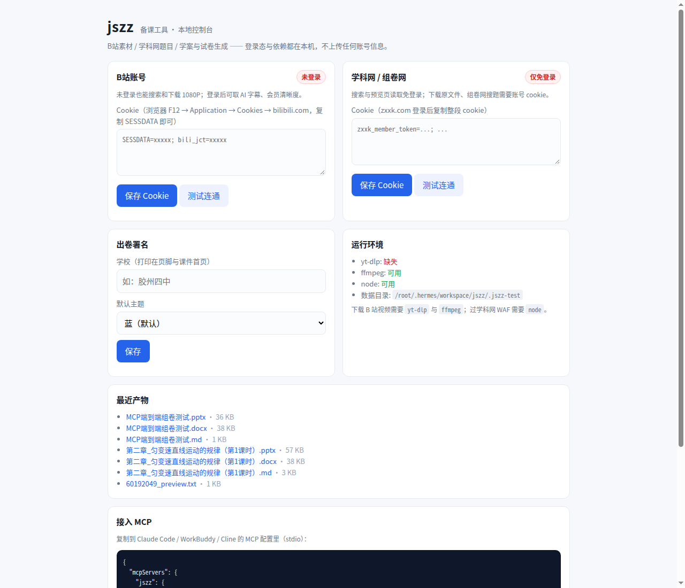

# jszz · 中学备课 MCP 工具集

给 **Agent** 用的备课工具箱：B站找素材 → 学科网取题 → 学案/试卷 → 一键出可打印
docx 和 16:9 课件。装一次，任何支持 MCP 的客户端（WorkBuddy / Claude Code / Cline /
Cherry Studio …）都能调。

> 排版风格不是拍脑袋：从一位一线教师 U 盘里的 **745 份真实教学资料**（25 份学案、
> 147 份试卷类文档、213 份课件、56 份真题 PDF）逐份抽出结构、字体、字号、页数、
> 每页字数后统计出来的。见 [`docs/corpus-analysis.md`](docs/corpus-analysis.md)。

## 长什么样

| 课件封面 | 例题页（右侧红色批注框） |
|---|---|
|  |  |

| 学案（A4 打印，含页眉/红条提醒） | 试卷（A4 打印，2×2 选项） |
|---|---|
|  |  |

| 讲评课件（答案 + 解析） | 本地控制台 |
|---|---|
|  |  |

## 能力

| # | 能力 | 工具 |
|---|---|---|
| 1 | B站搜索 / 详情 / 字幕 / 音视频下载 | `bili_search` `bili_video_info` `bili_subtitle` `bili_download` `bili_audio_stream` |
| 2 | 学科网搜索 / 版本清单 / 预览正文 / **还原 docx** / 抠图 / 组卷网搜题 | `zxxk_search` `zxxk_document` `zxxk_preview_files` `zxxk_preview_text` `zxxk_preview_docx` `zxxk_preview_images` `zxxk_questions` `zxxk_knowledge_questions` |
| 3 | 学案编写（docx） | `make_xuean` |
| 4 | 学案自动生成 PPT | `make_xuean(pptx=True)` |
| 5 | 试卷编写 / 组卷（docx，带答案页） | `make_paper_md` `assemble_paper` |
| 6 | 试卷转讲评 PPT | `make_paper_md(pptx=True)` |
| 7 | 登录态 / 依赖自检 / 产物下载的本地控制台 | `jszz web` |
| 9 | 产出体检（越界/溢出/占位符/空白页/表格超宽） | `lint_markdown` · `jszz check` |
| 10 | B站扫码登录（官方二维码 API，无需浏览器） | 控制台「获取二维码」 |
| 8 | 技能包 `jszz.skill`（SKILL.md + 6 篇排版规范） | 下载仓库根目录的 `jszz.skill` |

## 安装

```bash
git clone https://github.com/wohongshi/jszz.git
cd jszz
pip install -e .                         # 装 jszz 命令 + mcp/requests/python-docx/python-pptx
sudo apt install nodejs                  # 过学科网 WAF 必需
pip install yt-dlp && sudo apt install ffmpeg   # 可选：下载 B 站音视频
```

> 不想装成包也行：`pip install -r requirements.txt`，把命令里的 `jszz` 换成
> `python -m jszz.cli`，`PYTHONPATH` 指向 `server/`。

## 接入 MCP

**stdio（推荐，WorkBuddy / Claude Code / Cline 都支持）**

```json
{
  "mcpServers": {
    "jszz": {
      "command": "python3",
      "args": ["-m", "jszz.server"],
      "env": {
        "PYTHONPATH": "/绝对路径/jszz/server",
        "JSZZ_HOME": "/绝对路径/.jszz"
      }
    }
  }
}
```

**HTTP**（远程/多人共用）：

```bash
jszz serve --http --port 8765     # streamable-http 端点 http://127.0.0.1:8765/mcp
```

## 打开控制台（登录 / 依赖 / 产物）

```bash
jszz web            # http://127.0.0.1:8770/
```

- **B站扫码登录**：点「获取二维码」→ B 站 App 扫一扫 → 自动写入 cookie（也可手动粘贴 SESSDATA）
- 学科网 cookie：解锁原文件下载与组卷网搜题；不填也能搜索、能读预览页
- 依赖自检：`yt-dlp` / `ffmpeg` / `node`
- 一键复制 MCP 配置

## 三分钟跑通

```bash
# 1. 命令行试一下（不用 MCP 客户端）
jszz set school 胶州四中
jszz search "匀变速直线运动" --limit 5
jszz xuean examples/xuean-wuli.md        # → ~/.jszz/out/xuean/*.docx / *.pptx
jszz paper examples/paper-wuli.md        # → ~/.jszz/out/paper/*.docx / *.pptx

# 2. 在 Agent 里
#    "用 jszz 出一份《匀变速直线运动》第1课时的学案和课件"
#    "从学科网找 3 道动量守恒的题，组一份 100 分的小卷"
```

## 设计要点

**学科网预览 JSON = 版本清单。** 未文档化接口 `FirstLoadPreviewJson` 一次给出
「原卷版 / 解析版」各自的**预览页数**与**全本页数**（例：2/5 页、3/23 页），
据此判断值不值 下载。免费预览只给前 3–5 页，全本要账号点数。

**预览页可以还原成可编辑 docx。** 预览页是 SVG：文字带坐标、公式与几何图是内嵌 base64 位图。
`zxxk_preview_docx` 按坐标把文字重排成行、把位图插回原位置，得到一份能改的卷子
（实测一份数学卷：1 065 字 + 45 张内嵌图）。坑有三个：`x` 是逐字形坐标列表、
`font-size` 挂在父级 `<g>`、还有一层 y=0 的隐藏文本层要剔除。

**学科网预览页 = 免费题库。** 资料详情页的预览页是矢量 SVG，文字节点可直接提取，
不用登录、不消耗点数。`zxxk_preview_text` 把 SVG 按坐标还原成阅读顺序的纯文本，
一份 5 页卷子的前几页能完整还原（公式与几何图是位图，会缺）。

**WAF 用页面自己的 JS 解。** 学科网/组卷网在阿里云 WAF 后面（`alicfw` 与 `acw_sc__v2`
两套挑战），本工具用 Node 的 `vm` 跑页面脚本来算 cookie，不引浏览器、不装 Playwright。
出口 IP 被拉黑时仍会失败，这是网络问题，不是代码问题。

**排版参数来自语料。** 学案 A4/宋体12pt/行距1.5/填空式预习 + 页眉「编写人/审核/时间」；
试卷 2×2 选项、题干悬挂缩进、答案另页 + 速查表；课件 16:9、正文 28pt、每页 184 字、
例题拆「题干页 + 解析页」。

**三色分工是从真实课件拆出来的。** 深蓝=框架（页头/封面块/书脊），青蓝=连接（色带/chip/
序号块），**红色只标「这里容易错」**（特别提醒、判定要点、`【标签】`）。真实课件里红色
只出现在这三处——满屏红等于没有红。

**两套页头。** 栏目式用于目标/考情/小结，通栏式（深蓝通栏白字）用于考点/知识点/例题/答案，
翻页时读者靠页头形态就知道自己在哪一类页面。

**六科不是一套模板。** 语文按「字词→活用→句式→常识」五层、数学按「知识诊断+考点1–3」、
英语按「一话题四件套」、物理化学按「知识点→考向→真题」、生物按「精读教材→教考衔接→练透考法」。
`skill/references/07-六科学案模板.md` 是从 100+ 份真实学案里逆向出来的。

**产出体检。** `lint_markdown` 检查写作层（挖空配对、大题分值、选项写法、题号跳号），
`jszz check` 检查文件层（形状越界、文本框溢出、占位符残留、空白页、表格超宽、页眉缺失）。

## 目录

```
server/jszz/
  server.py        MCP 工具定义（15 个）
  bilibili.py      WBI 签名、搜索、字幕、下载
  zxxk.py          学科网搜索/详情/预览页、组卷网
  waf.py           WAF 挑战求解（调 bin/fetch_alicfw.js）
  mdparse.py       教师风格 Markdown → 文档模型
  docx_render.py   学案/试卷 A4 排版
  pptx_render.py   16:9 课件（新授课 / 讲评课）
  assemble.py      组卷
  webui.py         本地控制台（标准库，零依赖）
  cli.py           命令行
skill/             jszz.skill（SKILL.md + 7 篇规范，含六科学案模板）
docs/六科内容地图.md  100+ 份真实学案/课件的内容清单与教学法
examples/          可直接跑的示例
docs/              语料分析报告
```

## 已知限制

- 组卷网（zujuan）反爬强，机房 IP 常被直接阻断；学校/家庭宽带一般可用
- 学科网原文件下载需要账号点数，本工具不绕过付费
- 预览页里的公式、几何图是位图，纯文本提取会缺；数学/物理需要老师补图
- 下载 B 站视频依赖 `yt-dlp`，其接口随 B 站改动，升级 `yt-dlp` 即可

## License

MIT
