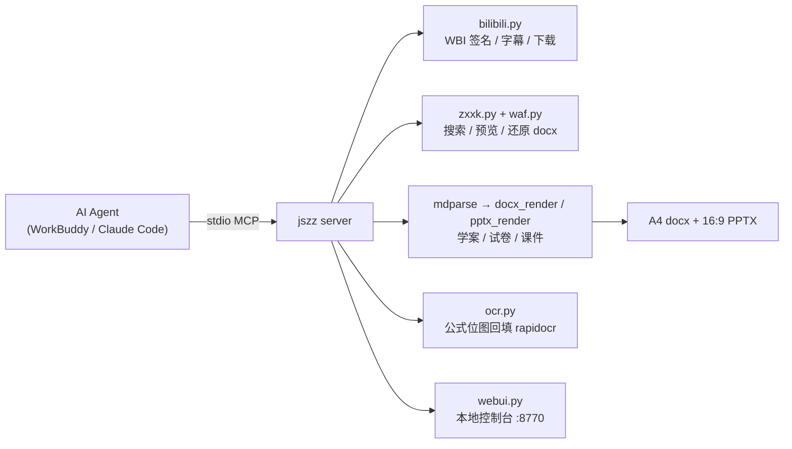

<p align="center">
  
</p>

<h3 align="center">jszz · 中学备课 MCP 工具集</h3>

<p align="center">
  给 <b>Agent</b> 用的备课工具箱：B站找素材 → 学科网取题 → 学案/试卷/课件一键出。<br>
  排版规范不是拍脑袋：837 份真实教师资料、892 万字符逐份统计逆向而来。
</p>

<p align="center">
  
  
  
  
  
</p>

<p align="center">
  装一次，任何支持 MCP 的客户端（<b>WorkBuddy</b> / Claude Code / Cline / Cherry Studio）都能调。
</p>

---

## 它解决什么问题

| 层 | 负责 | 换掉它意味着 |
|---|---|---|
| **素材获取** | B站搜/字幕/音视频下载；学科网搜资料、读预览、**还原可编辑 docx** | 手动翻网页、手抄题目 |
| **文档生成** | 学案/试卷 → 可打印 A4 docx；课件 → 16:9 PPT（六科各一套视觉） | 一晚上手动排版 |
| **版式规范** | 从 837 份真实资料逆向的字体/字号/栏目词表/配色/页眉页脚 | 「差不多就行」的 AI 排版 |

## 长什么样

| WebUI 控制台 | 六科课件封面（真实渲染） |
|---|---|
|  |  |

| 学案（A4，页眉/填空/红条提醒） | 试卷（A4，2×2 选项） |
|---|---|
|  |  |

| 六科专属页型 | 讲评课件（答案 + 解析） |
|---|---|
|  |  |

## ✨ 亮点

- 🎯 **规范从真实资料来**——837 个文件、892 万字符逐份统计（字体/字号/栏目/配色/页眉页脚），见 [`docs/corpus-analysis.md`](docs/corpus-analysis.md)
- 📄 **学案带答案版**——`make_xuean(answers=True)`：答案红色压下划线填回，与老师手写答案版同款
- 🖼️ **六科各一套 PPT 视觉**——封面/页头/装饰/专属页型都不同，按 `> 学科：` 自动选型
- 🔍 **公式 OCR 回填**——学科网预览的公式是位图，OCR 插回原行位置，讲评不再满屏空括号
- 🚀 **一键讲评**——`zxxk_review_deck(document_id)`：学科网资料 → 打印卷 + 讲评 PPT 一步到位
- 🧾 **产出体检**——越界/溢出/占位符残留/空白页自动查，`jszz check` 一条命令

## 架构



```
server/jszz/    22 个 MCP 工具 + 渲染器 + WebUI（5983 行）
skill/          SKILL.md + 10 篇排版规范（打包成 jszz.skill）
examples/       8 份六科样例 + 学案/试卷示例 Markdown
tests/          3 套测试（离线渲染 / MCP 端到端 / 学科网预览）
docs/           语料分析报告 · 六科内容地图 · 截图
```

## 安装

```bash
git clone https://github.com/wohongshi/jszz.git
cd jszz
pip install -e .                         # jszz 命令 + mcp/python-docx/python-pptx/rapidocr
sudo apt install nodejs                  # 过学科网 WAF 必需
pip install yt-dlp && sudo apt install ffmpeg   # 可选：下载 B 站音视频
```

> 不想装成包也行：`pip install -r requirements.txt`，把命令里的 `jszz` 换成
> `python -m jszz.cli`，`PYTHONPATH` 指向 `server/`。

## 接入 MCP

**stdio（推荐，WorkBuddy / Claude Code / Cline 都支持）**

```json
{
  "mcpServers": {
    "jszz": {
      "command": "python3",
      "args": ["-m", "jszz.server"],
      "env": {
        "PYTHONPATH": "/绝对路径/jszz/server",
        "JSZZ_HOME": "/绝对路径/.jszz"
      }
    }
  }
}
```

**HTTP**（远程/多人共用）：

```bash
jszz serve --http --port 8765     # streamable-http 端点 http://127.0.0.1:8765/mcp
```

## 打开控制台（登录 / 依赖 / 产物）

```bash
jszz web            # http://127.0.0.1:8770/
```

- **B站扫码登录**：点「获取二维码」→ B 站 App 扫一扫 → 自动写入 cookie（也可手动粘贴）
- 学科网 cookie：解锁原文件下载与组卷网搜题；不填也能搜索、能读预览页
- 依赖自检：`yt-dlp` / `ffmpeg` / `node`；一键复制 MCP 配置

## 三分钟跑通

```bash
# 1. 命令行试一下（不用 MCP 客户端）
jszz set school 胶州四中
jszz search "匀变速直线运动" --limit 5
jszz xuean examples/xuean-wuli.md --answers   # → docx + 答案版 + pptx
jszz paper examples/paper-wuli.md             # → docx + 讲评 pptx

# 2. 在 Agent 里
#    "用 jszz 出一份《匀变速直线运动》第1课时的学案和课件"
#    "从学科网找 3 道动量守恒的题，组一份 100 分的小卷"
#    "把这个学科网卷子直接出成讲评 PPT"
```

## 能力一览

| # | 能力 | 工具 |
|---|---|---|
| 1 | B站搜索 / 详情 / 字幕 / 音视频下载 | `bili_search` `bili_video_info` `bili_subtitle` `bili_download` `bili_audio_stream` |
| 2 | 学科网搜索 / 版本清单 / 预览正文 / **还原 docx** / 抠图 / 组卷网搜题 | `zxxk_search` `zxxk_document` `zxxk_preview_files` `zxxk_preview_text` `zxxk_preview_docx` `zxxk_preview_images` `zxxk_questions` `zxxk_knowledge_questions` |
| 3 | **一键讲评**（学科网资料 → docx + 讲评 PPT） | `zxxk_review_deck` |
| 4 | **OCR**：预览页公式回填 / 任意图片转文字（水印过滤、落盘缓存） | `zxxk_preview_ocr` `jszz_ocr` |
| 5 | 学案编写（docx，可出答案版） | `make_xuean` |
| 6 | 学案自动生成 PPT（六科视觉） | `make_xuean(pptx=True)` |
| 7 | 试卷编写 / 组卷（docx，带答案页） | `make_paper_md` `assemble_paper` |
| 8 | 试卷转讲评 PPT（跟随学科风格） | `make_paper_md(pptx=True)` |
| 9 | 产出体检 / 状态 / 配置 | `lint_markdown` `jszz_status` `jszz_configure` |

## 排版规范怎么来的

不是「AI 觉得好看」，是对一线教师的真实资料逐份测量：

| 取证 | 规模 | 产出规范 |
|---|---|---|
| 全量语料统计 | 837 个文件、892 万字符（557 pptx / 125 docx / 56 pdf） | 字号/栏目/结构骨架 → `docs/corpus-analysis.md` |
| 课件逐页目视 + XML | 17 份真实课件（每科 2–3 份） | 六科 PPT 视觉语言 → `references/09` |
| 学案/试卷 run 级样式 | 11 份 docx（含真实答案版对比） | 答案版/页眉/选项排布 → `references/10` |
| 内容骨架 | 100+ 份真实学案/课件 | 六科学案模板 → `references/07` |

<details><summary>六科样例与专属页型（点击展开）</summary>

| 学科 | 封面 | 专属页型 | 触发指令 |
|---|---|---|---|
| 语文 | 提示横条 + 黄底篇目标签 | 引文页 | `> 引文：…——出处` |
| 数学 | 细线框标题牌 + 彩色标签组 | 公式页 | `> 公式：… \| 条件：… \| 结论：…` |
| 英语 | Learning aims + 青色【栏目】块 | 英汉对照页 | `> 对照：EN \| 中文` |
| 物理 | 深蓝轨道弧线 + 页码方块 | 公式页 | 同数学 |
| 化学 | 试管卡片 + 蓝胶囊页头 | 反应式页 | `> 反应：… \| 条件：…` |
| 生物 | 绿块栏目 + 放射概念图 | 概念图页 | `> 概念：中心词 > 分支：…` |

</details>

<details><summary>设计要点（点击展开）</summary>

**学科网预览 JSON = 版本清单。** 未文档化接口 `FirstLoadPreviewJson` 一次给出
「原卷版 / 解析版」各自的预览页数与全本页数，据此判断值不值得下载。

**预览页可以还原成可编辑 docx。** 预览页是 SVG：文字带坐标、公式是内嵌位图。
`zxxk_preview_docx` 按坐标把文字重排成行、位图插回原位（实测一份数学卷：
1065 字 + 45 张内嵌图）。坑有三个：`x` 是逐字形坐标列表、`font-size` 挂在父级
`<g>`、还有一层 y=0 隐藏文本层要剔除。

**WAF 用页面自己的 JS 解。** 学科网/组卷网在阿里云 WAF 后面，本工具用 Node `vm`
跑页面脚本算 cookie，不引浏览器、不装 Playwright。

**排版参数来自语料。** 学案 A4/宋体 12pt/行距 1.8/填空式预习 + 页眉四栏；
试卷选项按宽度 4→2→1 列自适应、答案另页 + 速查表；课件 16:9、正文 28pt、
每页 184 字、例题拆「题干页 + 解析页」。

**三色分工从真实课件拆出。** 红=答案/纠错/易错（六科通吃），蓝=标题/要点/解析，
黄=高亮标签。满屏红等于没有红。

**产出体检。** `lint_markdown` 查写作层（挖空配对、大题分值、选项写法），
`jszz check` 查文件层（形状越界、文本框溢出、占位符残留、空白页、表格超宽）。

</details>

## 测试

```bash
./tests/selftest.py          # 离线渲染自检（docx/pptx 版式断言）
./tests/test_mcp.py          # MCP stdio 端到端（22 工具注册 + 生成链路）
./tests/test_zxxk_preview.py # 学科网预览接口（需网络）
```

## 已知限制

<details><summary>如实声明（点击展开）</summary>

- 学科网预览的**公式是位图**：还原 docx 里是图不是 OMML 公式；OCR 回填是
  「尽力而为」，符号不保证全对，印刷前人工核对
- 学科网**免费预览只有 3–5 页**，全本要下载原件（需要账号点数，本工具不绕过付费）
- 组卷网（zujuan）反爬强，机房 IP 常被直接阻断；学校/家庭宽带一般可用
- 下载 B 站视频依赖 `yt-dlp`，其接口随 B 站改动，升级 `yt-dlp` 即可

</details>

## 文档索引

| 文档 | 内容 |
|---|---|
| [`docs/corpus-analysis.md`](docs/corpus-analysis.md) | 837 份语料的统计报告（数字出处） |
| [`docs/六科内容地图.md`](docs/六科内容地图.md) | 六科内容骨架与教法 |
| [`skill/SKILL.md`](skill/SKILL.md) | 给 AI Agent 的完整使用说明 |
| `skill/references/01–10` | 学案/试卷/课件/Markdown/学科网/B站/模板/视觉/取证规范 |

## License

MIT
